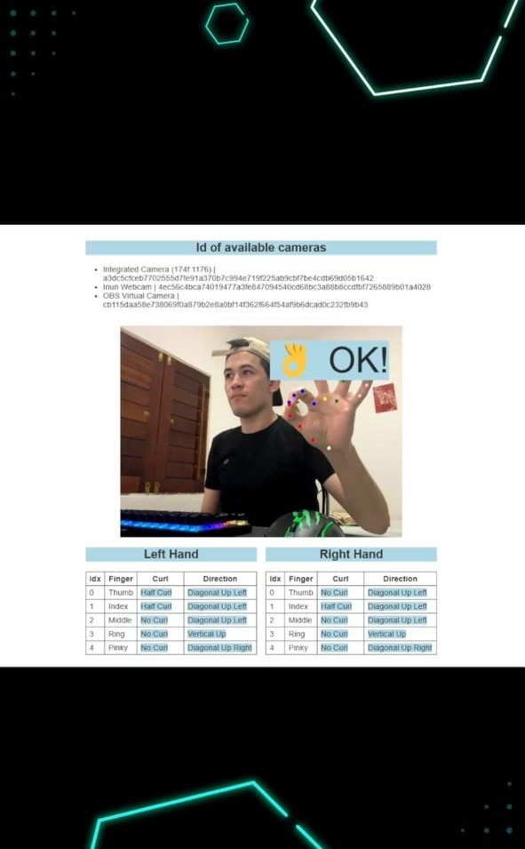
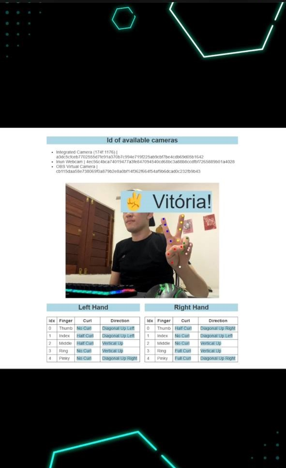

# Detect Fingerpose Gestures

Real-time hand gesture recognition in the browser. Point your webcam at your hands and the app shows an emoji and a label for each recognized gesture, for both hands at the same time.

<div style="display:flex;">


</div>

## 🌟 About

fingerpose-gestures is a web app built on top of the [Fingerpose](https://www.npmjs.com/package/fingerpose) classifier, using the hand landmarks detected by TensorFlow.js' [hand-pose-detection](https://www.npmjs.com/package/@tensorflow-models/hand-pose-detection) model (MediaPipe Hands runtime). It ships with 15 custom gestures and a debug table showing the curl and direction of every finger.

## ⚙️ How it works

Gesture detection works in 3 steps:

1. Detect the 21 landmarks of each hand in the video frame
2. Estimate the curl and direction of each individual finger
3. Compare the result against a set of gesture descriptions and pick the best match

**Step (1) is performed by [hand-pose-detection](https://www.npmjs.com/package/@tensorflow-models/hand-pose-detection) with [MediaPipe Hands](https://www.npmjs.com/package/@mediapipe/hands).
Steps (2) and (3) are handled by the [fingerpose](https://www.npmjs.com/package/fingerpose) library.**

## 👨‍💻 Technologies used

<p>


</p>

| Library | Version |
| ------- | ------- |
| [@tensorflow/tfjs-core](https://www.npmjs.com/package/@tensorflow/tfjs-core) | 4.22.0 |
| [@tensorflow/tfjs-backend-webgl](https://www.npmjs.com/package/@tensorflow/tfjs-backend-webgl) | 4.22.0 |
| [@tensorflow-models/hand-pose-detection](https://www.npmjs.com/package/@tensorflow-models/hand-pose-detection) | 2.0.1 |
| [@mediapipe/hands](https://www.npmjs.com/package/@mediapipe/hands) | 0.4.1675469240 |
| [fingerpose](https://www.npmjs.com/package/fingerpose) | 0.1.0 |
| [browser-sync](https://www.npmjs.com/package/browser-sync) (dev server) | 3.x |

The runtime libraries are loaded from the jsDelivr CDN in `index.html`, so there is no build step.

## ✋ Supported gestures

| Name          | Shown as         |
| ------------- | ---------------- |
| `thumbs_up`   | 👍 Legal!        |
| `thumbs_down` | 👎 Péssimo!      |
| `rock`        | ✊️ Punho         |
| `paper`       | 🖐 Oi            |
| `scissors`    | ✌️ Vitória!      |
| `middle`      | 🖕 Toma!         |
| `fazol`       | 👆 Faz o L       |
| `ok`          | 👌 OK!           |
| `pinching`    | 🤏 Vish          |
| `painLeft`    | 👈 Bolsonaro?    |
| `top`         | ☝️ Acima         |
| `show`        | 🤙 Show          |
| `yes`         | 🤟 Rock          |
| `horn`        | 🤘 Corno?        |
| `rightHand`   | 🫱 Deitado       |

## 🚀 Running the project

**Requirements:** [Node.js](https://nodejs.org/), a webcam and a browser with WebGL support.

Clone the repository and install the dependencies:

```sh
git clone https://github.com/davigomesflorencio/fingerpose_gestures
cd fingerpose_gestures
npm install
```

Start the development server:

```sh
npm start
```

Browser-sync opens the app in your browser and reloads it whenever a file in `src/` changes. Allow camera access when the browser asks for it.

## 🎥 Webcam configuration

The webcam settings live in the `config` object at the top of `src/index.js`:

```js
var config = {
  video: {
    width: 640,
    height: 360,
    fps: 30,
    // id: "",
  },
};
```

- `width` / `height`: resolution requested from the camera
- `fps`: how many frames per second are analyzed
- `id`: the camera to use. When the app starts, it lists every available camera with its id under **Id of available cameras**. Copy one of them here to pick a specific camera; leave it commented out to use the default one.

## ➕ Adding a new gesture

Gestures are described in `src/gestures.js` with Fingerpose's `GestureDescription`:

1. Add the gesture name to the `icons` array and a matching variable to the destructuring list right below it (same position in both).
2. Describe the curl and direction of each finger:

   ```js
   myGesture.addCurl(Finger.Index, FingerCurl.NoCurl, 1.0);
   myGesture.addDirection(Finger.Index, FingerDirection.VerticalUp, 1.0);
   ```

3. Add the variable to the `gestures` array at the end of the file.
4. Add the text to show for it to `gestureStrings` in `src/index.js`, using the same name as the key.

The debug tables below the video show the live curl and direction of each finger, which helps when tuning a new gesture.

## 📝 Changelog

See [CHANGELOG.md](CHANGELOG.md).

## 📃 License

[Apache License 2.0](LICENSE)
